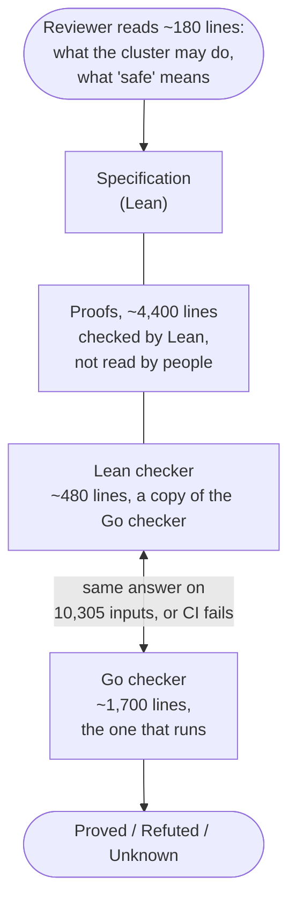

In [the last post][prev] I argued for a simple idea: **don't trust the AI's plan; trust a checker small enough to read.** An AI agent writes a plan to change a Kubernetes cluster. A small checker with no AI in it, [planproof][repo], plays the plan out step by step and says *Proved*, *Refuted* or *Unknown*, with a one-page report a person can read.

Why trust that checker? Last time the answer was: it's about 1,700 lines of plain Go, every rule is tested both ways, it was fuzzed, and its predictions matched a real cluster. That's good engineering. But it's still an argument from examples. Tests show the checker is right on the cases someone thought of, or a random generator happened to hit.

This post is about the next step: writing the checker's rules down precisely in [Lean][lean], a proof assistant, and **proving** that when the checker says Proved, the rules hold. Not for 10,000 plans. For every plan.

**In short:**

- **What changed:** a Lean copy of the checker is now proved correct for six of its 13 rules, the core ones, for every possible plan, cluster snapshot and policy. The Go checker that actually runs is tied to the proved copy by tests that run both on 10,305 inputs and fail on any difference.
- **What a reviewer reads:** about 180 lines that say what the cluster may do and what "safe" means. Not the checker, and not the 4,400 lines of proof: Lean checks those mechanically.
- **What it found:** writing the rules down precisely found **three real bugs** in the original checker. Each was a plan it approved although a real run could take a service down to zero. 10,000 randomly generated test plans hadn't found any of them.
- **What it doesn't do:** it proves the checker matches *a model* of Kubernetes. Whether the model matches real Kubernetes is still tested, not proved. And it's still a demo, not a production system.

## Tested versus proved

Think of a bridge. You can drive a thousand trucks over it and watch it hold. Or an engineer can work out from the design that it holds *any* load up to its limit. The trucks are tests. The calculation is a proof. The calculation is only as good as its assumptions about steel and soil, which is why engineers still load-test the real bridge. But it covers the truck you didn't think to send.

**Why 10,000 tests isn't enough.** Suppose a checker is wrong once in 10,000 plans, a 0.01% chance. Ten thousand passing tests would miss that bug 37% of the time. In production, over 10,000 plans, the chance it strikes at least once is 63%, and over 100,000 plans it's near certain:

| A bug that strikes once in 10,000 plans | Chance |
| --- | --- |
| 10,000 passing tests miss it | 37% |
| It strikes at least once in 10,000 real plans | 63% |
| It strikes at least once in 100,000 real plans | over 99.99% |

(The chance of missing it every time in *n* tries is (1 − 0.0001)<sup>*n*</sup>, about 37% at *n* = 10,000. Put the other way, 10,000 clean tests only show the failure rate is probably below about 0.03%, the ["rule of three"][ruleofthree] (Hanley and Lippman-Hand, 1983).)

Real bugs are worse than this arithmetic, because they don't strike at random: they hide in corner cases that random tests rarely reach. None of planproof's 10,000 generated plans reached the first bug described below. For most code, tests are still the right trade-off. For the small core that every decision depends on, a proof covers every case, not just the ones sampled.

A proof assistant makes the calculation impossible to fake. You write the claim, you write the argument, and Lean checks every step. If one step doesn't follow, it refuses. This is the same idea planproof is built on, one level down: a clever, untrusted author (here, whoever writes the proof) and a small, strict checker (Lean's kernel) that has the final say.

That has a nice consequence. **I didn't write most of the proofs by hand. An AI assistant (Claude) drafted them, and Lean checked them.** I don't need to trust the AI, or even read the proofs, because Lean won't accept a wrong one. CI also rejects every way to cheat: the `sorry` placeholder that skips a step, extra assumed axioms, and anything that swaps in different code at run time. It's the same pattern planproof applies to AI-written plans.

## The new picture



There are now two checkers. The Go one is unchanged in role: it's what the command line runs. The Lean one is a function-by-function copy that can be reasoned about. The proofs connect the Lean copy to the specification. **Differential tests** connect it to the Go original: both run on the same 305 hand-made and recorded inputs and 10,000 generated plans, and CI fails if they ever give a different answer.

This split isn't my idea. It's how AWS builds [Cedar][cedar], its authorization language: a Lean model with proofs, and differential random testing of the Rust code against it. A new Cedar release doesn't ship unless the model, proofs and tests are up to date.

## What is proved

If the Lean checker says Proved, then:

| Rule | In plain English |
| --- | --- |
| `frame` | The plan changes exactly what its goal says, and nothing else. |
| `cordon-first` | Every node is closed to new pods before it is emptied. |
| `limits` | After every step, the number of machines closed to new pods, and of machines open to them, stays within the policy's limits, or no worse than before the plan. |
| `budget` and `never-zero` | At **every moment** of **every way the plan can really run**, each service keeps the minimum copies its disruption budget asks for (or no fewer than it had before the plan), and no service that's running loses its last copy. "Every way" means wherever the scheduler places pods, whenever they become ready, and however the rolling updates go. |
| `capacity` | After every step, the placement the checker worked out fits every machine, or leaves it no fuller than before the plan. |

The part I find most useful is "every way the plan can really run." The checker uses a simplified, pessimistic picture of the cluster, which is what makes it fast and small. The proof shows that picture is *never too optimistic*: whatever Kubernetes actually does within the model, the real number of ready pods is at least the number the checker counted.

## What "safe" looks like in the specification

The specification is meant to be read. Here's the whole definition of the never-zero rule:

```lean
def NeverZero (s : Snapshot) (p : Plan) (pol : Policy) (w : World) : Prop :=
  ∀ sd ∈ s.deployments, (World.initial s).avail (depName sd) ≥ 1 →
    zeroAllowed p pol (depName sd) = false →
    w.avail (depName sd) ≥ 1
```

Read it as: *for every service in the snapshot that had at least one ready pod, unless the goal scales it to zero and the policy allows that, the world `w` still has at least one available.* A separate definition says which worlds `w` a plan can reach, step by step. The main theorem says this holds in all of them.

How do you prove a claim about every possible run? The trick is decades old. Define a relation that says "this simplified state stands for that real situation", then prove that each operation keeps the relation. Robin Milner called this a [simulation between programs in 1971][milner]. Patrick and Radhia Cousot built the theory of sound simplified pictures, [abstract interpretation, in 1977][cousot]. The planproof proof is one such argument per operation (drain, scale, image change and so on), plus one showing the simplified count never exceeds the real one.

## What writing it down found

The proofs weren't the most valuable part. The most valuable part was having to write down, precisely, **what Kubernetes is allowed to do** at each step. That found three bugs in the original checker, all of the same kind: the checker forgot one thing Kubernetes might do, and so approved a plan that could take a service to zero.

1. **A pod that never moved.** When a node is drained, a pod that *might* have been on it is moved somewhere. The checker assumed "to a safe node". But the pod might have been on a different node all along, the very one the plan drained next. A plan that scales `cart` from 1 to 2, closes two nodes, drains the first, waits and drains the second was approved, although both `cart` pods could be on the second node.
2. **Old pods during an update.** During a rolling image update, the old pods keep running on their old nodes until the new ones are ready. The checker stopped tracking them when the update started, so it missed that draining their node could remove an old pod before any new one was ready.
3. **A pod still waiting for a node.** A new pod that hasn't been scheduled yet can land on a node the moment that node is reopened. The checker had fixed the pod's list of possible nodes when it created it, so it missed this.

**No test had caught any of them.** Of the 10,000 generated plans, none hit the first bug, and the 10 that reached the second were all refused for other reasons. Each fix shipped with the failing plan added to the test table, and the checker's version went from 0.2.0 to 0.5.0. No result in the earlier post changed.

This matches what others report. AWS engineers reported in 2015 that [precise specifications in TLA+][awsfm] found subtle, serious bugs in critical services, bugs they believed other methods would have missed. The Cedar team found 4 bugs while doing proofs, and 21 more with differential and property-based testing ([Disselkoen et al., 2024][cedar]). Precision finds the cases nobody thought to test.

## The previous checker and the proved one, side by side

| | First version ([previous post][prev]) | Now |
| --- | --- | --- |
| **Why trust it** | Small (about 1,700 lines), no AI, every rule tested both ways, fuzzed, compared with a real cluster | The same, plus a machine-checked proof for the Lean copy |
| **What a reviewer reads** | The whole checker, about an afternoon | About 180 lines of specification, plus the list of assumptions |
| **Kind of evidence** | Examples: unit tests, 25 bad plans, 10,000 generated plans, a real cluster | All plans, snapshots and policies within the model, for six core rules |
| **Rules covered** | All 13, by tests | 6 proved (one only in part); the other 7 tested. Six of those 7 are also in the Lean copy and checked to agree with Go; `input` (parsing) is Go only |
| **How Go is trusted** | It *is* the checker | It agrees with the proved copy on 10,305 inputs |
| **Bugs found** | Bugs the tests could see | Three that 10,000 generated plans missed |
| **What could still be wrong** | Any rule on an untested input; the model | The model; the 7 unproved rules and the static half of `limits`; Go and Lean differing on an input the tests don't cover |
| **Cost** | Phases 1 to 4 | About two days of work after the design: 4,400 lines of proof, drafted by an AI and checked by Lean |

The second version doesn't replace the first. Every test from before still runs. The proof adds a guarantee that tests can't give, and moves the remaining risk somewhere smaller and easier to name.

## How much to trust the link between the two checkers

The Go checker is only tested against the proved copy. So it's fair to ask whether those tests would actually notice a difference. I checked by planting bugs in the Go checker on purpose:

- **An off-by-one in the budget rule:** 149 of the 305 recorded inputs and 886 of 3,000 generated plans disagreed. The tests caught it at once.
- **Scale-down removing ready pods first** instead of pods that aren't ready: none of the recorded inputs disagreed, but 9 of 10,000 generated plans did. That's why the generated set is 10,000 plans and not a few hundred.

There's public evidence for this split too. The [Csmith project][csmith] tested C compilers with random programs for years. It made every compiler it tried silently produce wrong code, except the formally verified middle of [CompCert][compcert]. The bugs it did find in CompCert were in the parts that weren't proved. Proofs move bugs to the unproved edges, so those edges need the testing.

## What it still doesn't do

- **It proves the checker matches a model of Kubernetes, not Kubernetes.** If the model is wrong, the proof is a proof about the wrong thing. The model was compared with a real cluster (it matched exactly in every run), but that's testing.
- **Only the Lean copy is proved.** The Go checker that runs is linked by tests, as described above.
- **Six of 13 rules are proved, one of them only in part.** The `limits` rule is proved after every step, but its static half (no replica count or wait time above the policy's maximum) is only tested. The other seven, such as "only touch services in scope" and "the rollback restores the goal", are tested only. The rollback's steps are covered by the six proved rules, though: they hold through the rollback too.
- **The proof assumes what input validation guarantees:** unique names, no negative numbers, and every step naming what it changes. It also assumes, like the checker always did, that ready pods stay ready and nothing else changes the cluster during the plan. The runner stops if either turns out false.
- **Capacity is about the checker's own placement.** The proof shows the placement it found fits. The real scheduler may choose a different one.
- **A person still checks the goal.** No proof can say whether "scale to 5" is what the ticket meant by "scale up".
- **It's a demo.** It shows how such a check can work; it isn't meant to run real clusters.

## Built on public work

| Idea | Where it comes from |
| --- | --- |
| Trust a small checker that checks a clever author's proofs | The LCF prover ([Gordon, Milner and Wadsworth, 1979][lcf]); the de Bruijn criterion ([Barendregt and Wiedijk, 2005][debruijn]); [Lean 4][lean4] |
| Passing tests only bound the failure rate; they can't rule a rare bug out | The rule of three ([Hanley and Lippman-Hand, 1983][ruleofthree]) |
| A proved model, with the real code tested against it | Cedar ([Disselkoen et al., 2024][cedar]) |
| Writing the spec precisely finds bugs testing misses | [Newcombe et al., 2015][awsfm] (TLA+ at AWS) |
| Each operation keeps a "stands for" relation | Simulation ([Milner, 1971][milner]) |
| A simplified picture that is never too optimistic | Abstract interpretation ([Cousot and Cousot, 1977][cousot]) |
| Prove the found placement fits, not the search that found it | Certifying algorithms ([McConnell et al., 2011][certifying]) |
| Verified parts stay clean; bugs move to the unverified edges | CompCert ([Leroy, 2009][compcert]) and Csmith ([Yang et al., 2011][csmith]) |

## What I'd take away

- **Write down what the world may do, precisely.** That found more than the proofs did. Even if you never finish a proof, the specification pays for itself.
- **Prove the small core and test the link.** The proof covers what tests can't. The tests tie the real code to the proved copy, and planted bugs show they'd notice a difference.
- **Let the AI write the proofs.** A proof checker is the ideal reviewer for AI output: it can't be talked round. That's the whole planproof argument, applied to planproof itself.
- **Say exactly what isn't covered.** "Proved" is a strong word. It's only honest next to a list of what it doesn't mean.

The specification, the proofs, and a page on what to review and what's only tested are in the repository's [`lean/` folder][leanreadme].

---

*This post was drafted with AI (Claude) from the project's requirements, proofs, test results and sources, then edited and checked by me.*

[prev]: 
[repo]: https://github.com/billykong/planproof
[leanreadme]: https://github.com/billykong/planproof/blob/main/lean/README.md
[lean]: https://lean-lang.org/
[lean4]: https://doi.org/10.1007/978-3-030-79876-5_37
[cedar]: https://arxiv.org/abs/2407.01688
[awsfm]: https://www.amazon.science/publications/how-amazon-web-services-uses-formal-methods
[milner]: https://mlanthology.org/ijcai/1971/milner1971ijcai-algebraic
[cousot]: https://doi.org/10.1145/512950.512973
[lcf]: https://doi.org/10.1007/3-540-09724-4
[debruijn]: https://doi.org/10.1098/rsta.2005.1650
[certifying]: https://doi.org/10.1016/j.cosrev.2010.09.009
[compcert]: https://doi.org/10.1145/1538788.1538814
[csmith]: https://www-old.cs.utah.edu/~regehr/papers/pldi11-preprint.pdf
[ruleofthree]: https://pubmed.ncbi.nlm.nih.gov/6827763/
