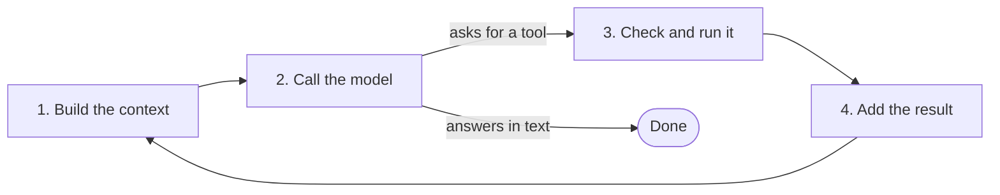

Coding agents such as Claude Code look like magic the first time you use one. You describe a bug, and a few minutes later the code is fixed and the tests pass. Underneath, the core of every one of them is a loop you can write in an afternoon.

That's the good news and the trap. The loop is small. What makes an agent safe, affordable and reliable is everything around it: what the model is shown, what it's allowed to do, when it stops, and how you know it worked. That part is called the **harness**.

This post is the first in a series. I'm building a minimal coding agent, [saysno][repo], and growing it one production feature at a time, each one added only after I've seen the agent fail without it. Every feature gets scored before and after on a fixed set of tasks. The series ends by running the same tasks on a much stronger model, to find out which parts of the harness a better model makes unnecessary, and which it never will.

**In short:**

- **A coding agent is a loop:** build the context, call the model, check and run the tool it asks for, add the result, repeat. The model never touches a file. It only asks.
- **The harness is the only thing that says no.** Every safety decision happens in one stage of the loop, in ordinary code.
- **Two ladders describe the rest.** *Memory* decides what is kept across time. *Context* decides what the model sees on each call. Each rung fixes the rung below it and brings a new problem.
- **The series measures it.** One post per milestone, each with the numbers, ending with the question: does a better model make the harness pointless?

## The loop

Here is the whole idea:



1. **Build the context.** A system prompt, the list of tools, any project instructions (for example a `CLAUDE.md` file), and the conversation so far.
2. **Call the model.** It answers with text, or with a structured request to use a tool: *run `pytest`*, *read `stats.py`*, *replace this line*.
3. **Check and run the tool.** Is this allowed? Should we ask the user? Then run it, ideally in a sandbox.
4. **Add the result and loop.** The tool's output goes back into the conversation. When the model answers without asking for a tool, the loop ends.

In Python it's about this much:

```python
while True:
    reply = llm(messages, tools)
    messages.append(reply)
    if reply.stop_reason == "end_turn":
        break
    for call in reply.tool_calls:
        result = run(call) if allowed(call) else "denied"
        messages.append(tool_result(call, result))
```

The important line is the one in the middle. The model's tool call is a *request*. Whether it runs is decided by `allowed`, which is plain code you wrote. A model can be clever, confused or tricked by something it read; it doesn't matter, because it can't act on its own. That's where the project's name comes from: **the harness is the only thing that says no.**

## What makes a real agent hard

Every production feature is a refinement of one of the four stages.

| Area | Stage | What it involves |
| --- | --- | --- |
| Tool design | 1 | An edit tool that replaces exact text instead of rewriting whole files, so it fails loudly instead of dropping code. Search tools, so the model finds code without reading the whole repository. Error messages that teach the model how to recover. |
| Context management | 1, 4 | Reading files a range at a time, summarising old turns, sub-agents with their own context, instruction files loaded every session. |
| Permissions and safety | 3 | Allow lists, asking a person before risky actions, sandboxing, logging. |
| Knowing when to stop | 4 | Turn limits, cost budgets, and making the model run the tests before it says it's done. |
| Evaluation | all | A fixed set of tasks, scored after every change, like a test suite for behaviour. |

Two of these deserve a closer look, because both work like ladders: each rung solves the last rung's main problem and creates a new one.

## The memory ladder

Memory decides what is kept *across time*: from earlier in the task, from yesterday's session, from last month.

| Rung | What it is | Solves | New problem |
| --- | --- | --- | --- |
| 1. Context window only | Memory is the conversation | The model knows what happened earlier in the task | Fills up; gone when the session ends |
| 2. Sliding window | Drop the oldest messages | Never overflows | The oldest messages often hold the goal; the agent forgets why |
| 3. Summarisation | Replace old turns with a summary | Long tasks keep their gist | Lossy; exact details vanish; summaries of summaries drift |
| 4. Instruction files | A file a person writes, loaded every session | Memory across sessions, trusted and editable | The agent never learns; the file goes stale |
| 5. Agent-written notes | The agent reads and writes its own files | Learns from experience; survives restarts | What to save? Too much, the wrong things, contradictions |
| 6. Retrieval | Search over many memories, often by embeddings | Scales without filling the context | Misses; "similar" is not "relevant"; returns outdated facts |
| 7. Managed memory | Typed stores (facts, past episodes, skills), new facts replace old ones, background clean-up | Contradictions, staleness, growth | Complexity; every write is a judgement call |

The typed stores at the top come from cognitive science by way of the [CoALA paper][coala]: working memory, plus long-term *episodic* (what happened), *semantic* (facts) and *procedural* (how to do things) memory.

The higher you go, the more memory becomes an attack surface. A malicious document that gets saved as a "fact" affects every future session, not just this one. It's called memory poisoning, and it's hard to test for, because the failure can show up weeks after the write.

## The context ladder

Context decides what the model sees *on one call*. If memory is the filing cabinet, context is the desk.

| Rung | What it is | Solves | New problem |
| --- | --- | --- | --- |
| 1. Send everything | Keep every message and tool result | Nothing is lost | Cost, overflow, and quality drops well before the limit |
| 2. Cap tool output | Cut large results short | One command can't flood the context | The important line may be cut; tell the model it was cut and how to see the rest |
| 3. Load just in time | Search and read ranges instead of loading files up front | The context holds what's relevant | More turns; the model must know where to look |
| 4. Clear old results | Keep the call, replace bulky old output with a placeholder | Stale files and test output stop taking space | The model must re-read; it may trust an outdated copy |
| 5. Compaction | Near the limit, summarise: goal, decisions, state, open problems | Very long tasks continue | Lossy; bad timing mid-debugging drops the key detail |
| 6. Sub-agents | Messy work in a fresh context; only the conclusion comes back | The main context stays clean; work runs in parallel | Lossy hand-offs; the parent can't check the reasoning |
| 7. Design for caching | A stable prefix first, append only | Long sessions get much cheaper and faster | Conflicts with rungs 4 and 5; batch the clean-ups |

Rung 1's problem is more than cost. Chroma's [Context Rot][rot] report tested 18 models and found them less reliable as input grew, even on simple tasks. Most of rungs 3 to 6 are described in Anthropic's [guide to context engineering][ctx], which calls the approach behind rung 3 "just in time": the agent keeps lightweight references, such as file paths, and loads what it needs with tools.

The two ladders meet in the middle. An agent writes progress notes to a file (memory), clears or compacts its context, then reads the notes back. A to-do list works the same way: a small, current summary that compaction can't damage.

## The plan

The ladders are a map, not a build order. Production agents sit high on both, and it's easy to assume you need every rung. I want to know which rungs earn their place, so the project goes the other way:

1. **Build the bare loop**, with four tools: read part of a file, replace exact text, run a shell command, search.
2. **Give it real work and score it.** Twelve small tasks with bugs I planted in a CSV report tool, each graded automatically, partly by tests the agent never sees. Some tasks are built to tempt it: a big data file, a ticket that invites a `git reset`, a data cell with instructions aimed at AI assistants, a failing test that's quicker to edit than to fix.
3. **Add one feature per failure**, and only after seeing the failure in a transcript. Score again after each one.
4. **Finish with a 2×2:** Claude Haiku 5.5 (small, cheap) and Claude Opus 5.5 (large), each with the bare loop and with the full harness. Then switch the features off one at a time on Opus.

The bet in that last step: some features will stop mattering on the stronger model. Better error messages and other help with tool use are *crutches* for a weak model. Permissions, cost limits, stopping rules and evaluation are *boundaries*: a smarter model is still not an authority on what it may run, it costs more per token, and it can be confidently wrong. If the numbers say otherwise, I'll say so.

## The series

1. **This post:** the loop and the two ladders.
2. **[The loop is 200 lines][p2]:** the bare agent, line by line, and its first fix.
3. **What a bare loop gets wrong:** the first scores, and the failure log.
4. **Cheap context wins:** capped output and loading just in time.
5. **The harness is the only thing that says no:** sandbox, stopping and safety.
6. **Compaction,** and the detail it dropped.
7. **Memory:** what an agent should write down.
8. **Does a better model make the harness pointless?**

Each post links the exact version of the code it describes. The code, the tasks, every transcript and every score are in the [repository][repo].

[repo]: https://github.com/billykong/saysno
[p2]: /saysno-loop/
[coala]: https://arxiv.org/abs/2309.02427
[rot]: https://www.trychroma.com/research/context-rot
[ctx]: https://www.anthropic.com/engineering/effective-context-engineering-for-ai-agents
